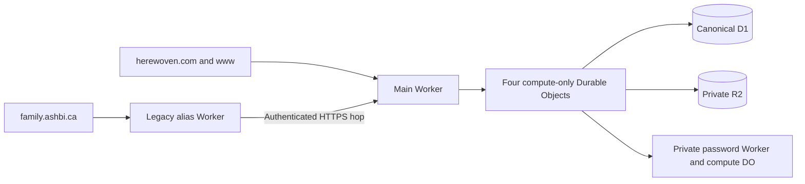

# Cloudflare runtime

Herewoven keeps one household, session and authorization model across web,
installed phone/tablet clients and the shared display. D1 is the canonical
runtime database. R2 is private and is read through authenticated app routes.
The legacy hostname is a transport bridge, never a second backend.

## Runtime boundaries

- Main app account: `1f5acce966c81fbe36ae06521414d0b8`.
  `wrangler.jsonc` binds D1 `herewoven`, R2 `herewoven-uploads`, private password
  compute and the app self-reference.
- The public entrypoint is `src/cloudflare/app-worker.mjs`. It retains the
  ASSETS policy, including `run_worker_first: ["/"]`, and delegates dynamic
  requests to four fixed `HerewovenComputePool` objects. The generated OpenNext
  worker remains the application implementation.
- Compute objects keep no household state, response cache, storage, alarms or
  scheduled work. Each dispatch gets its own request context and `waitUntil`.
  Eight concurrent dispatches per object are admitted; excess work receives an
  uncached 503. Writes are never automatically replayed by the router.
- This boundary addresses observed regular-Worker CPU-limit failures while
  preserving the complete app. Durable Objects have a documented default
  [30-second CPU budget](https://developers.cloudflare.com/durable-objects/platform/limits/)
  and SQLite classes are available without enabling Workers Paid. The migration
  does not authorize paid-plan activation.
- D1 readers retain the canonical schema and date convention. Native mutations
  retain ownership, atomic batches and replay/refusal contracts. No request-bound
  database session or Prisma I/O instance is cached across requests.
- `public/.assetsignore` excludes the Capacitor bootstrap `/index.html` from web
  asset delivery so it cannot shadow authenticated root routing.

## Existing native hostname

The `ashbi.ca` zone belongs to account `1b2e351cbb39ab6b80efe36ca3577fe5`.
Cloudflare cannot attach its Custom Domain directly to the main account's
Worker. `wrangler.legacy-alias.jsonc` therefore defines the narrow
`herewoven-legacy-alias` Worker in the old zone's account.

Only `family.ashbi.ca` and its explicit temporary QA hostname are accepted.
The bridge streams requests to an explicitly allowed Herewoven origin,
preserves cookies, body and cancellation, and rewrites owned redirects back to
the incoming origin. It preserves duplicate Set-Cookie values and leaves
external provider redirects unchanged. It has no database, bucket, session
store, auth implementation or scheduled job.

A managed shared secret attests the original client IP and host on the
cross-account hop. The main entrypoint validates it with constant-time digest
comparison, rejects malformed addresses, removes the private hop headers and
feeds the app one canonical forwarding hop. Ordinary callers cannot select
an IP or host with spoofed forwarding headers. App authentication, current
session generation and household/role checks still run normally.

The shared `*.ashbi.ca` DNS record is not part of this deployment and must not
be edited to move the family app. Use an exact hostname mapping. Keep the
browser-visible family origin for installed Capacitor clients.

## Release and recovery

Use an immutable Cloudflare CI artifact with recorded source and verified
module checksums. Confirm configuration/bindings separately from code identity;
local tests, temporary-edge acceptance and production acceptance are distinct.
The alias Worker is compiled from the same recorded source and its module
hash is retained before upload. Secret values never belong in source,
artifacts or operation logs.

The live rollout registry is [issue #604](https://github.com/camster91/family-planner/issues/604).
It owns current artifact/version identities, current-head CI, domain/TLS and
household/media proof, owned QA-record cleanup and decommission results.
Temporary workers.dev entrypoints are disabled after production verification.

The approved migration starts with fresh app data. The earlier VPS database
and uploads are recovery archives, not another active runtime data source.
Retain the named backup, verified restore and source image until cutover is
verified. Retire only the Herewoven application/database resources; shared
Coolify infrastructure and unrelated applications remain outside scope.
The historical VPS deployment job is removed from GitHub Actions so a manual
workflow dispatch cannot recreate the retired runtime. Its recovery scripts and
verified source image remain available for an explicitly approved rollback.
The image checks continue to cover compatibility; Cloudflare releases use the
immutable Worker artifact and the rollout registry above.
